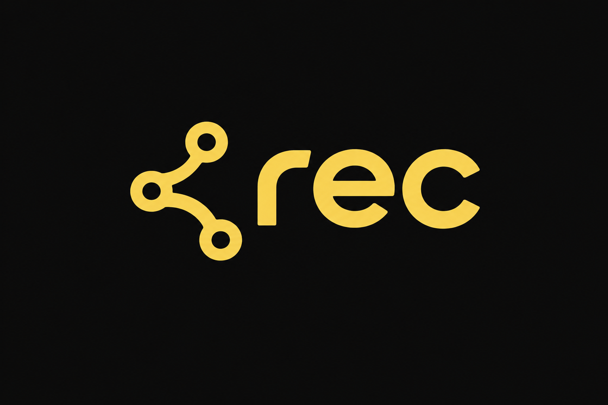
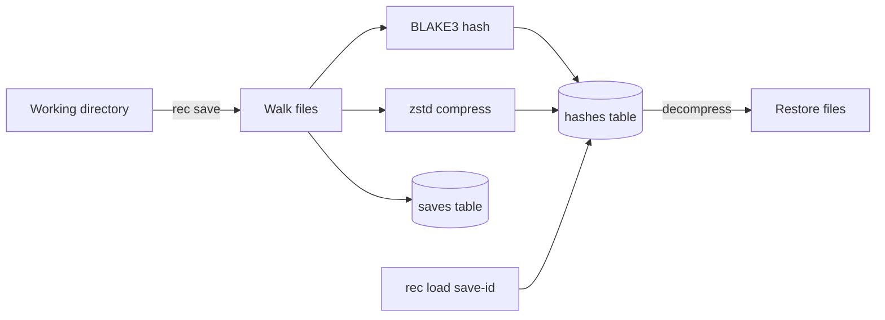

<p align="center">
  
</p>

<h1 align="center">rec</h1>

<p align="center">
  A fast, snapshot-based version control system written in Rust.
</p>

<p align="center">
  
  
  
  
</p>

**rec** is the command-line engine behind [RecBase](#recbase-and-the-bigger-picture), an independent
alternative to hosted code platforms such as GitHub. It does not wrap Git. Instead, rec records
complete snapshots of a working directory: every file is hashed with **BLAKE3**, compressed with
**zstd**, and stored as an object in a local **SQLite** database. A save is identified by a short ID,
and restoring it rewrites the files captured in that snapshot.

The project is designed around a small, predictable command set — `init`, `save`, `log`, and `load`
today, with branches, diffs, merging, and remote sync on the roadmap.

> [!NOTE]
> **Project status: early development.** The local snapshot workflow is functional, but rec is not
> yet a replacement for Git. Commands marked **Planned** below are listed in `rec`'s help output but
> are not implemented yet.

## Contents

- [Why rec](#why-rec)
- [Quick start](#quick-start)
- [Commands](#commands)
- [How it works](#how-it-works)
- [Configuration](#configuration)
- [Storage layout](#storage-layout)
- [Project structure](#project-structure)
- [Roadmap](#roadmap)
- [Limitations](#limitations)
- [RecBase and the bigger picture](#recbase-and-the-bigger-picture)
- [Documentation](#documentation)
- [Contributing](#contributing)
- [License](#license)
- [Acknowledgments](#acknowledgments)

## Why rec

Git is powerful, but its command set and staging model are large. rec explores a simpler model:

- **Snapshot-based, not patch-based.** `rec save` captures the current state of the directory. There
  is no staging area and no index to manage.
- **Hash-verified content.** Every file's content is hashed with BLAKE3, which makes integrity checks
  cheap and opens the door to object deduplication during sync.
- **Compressed at rest.** File contents are stored with zstd, so snapshots take less disk space than
  a plain copy of the project.
- **Local-first.** Saves live in a single SQLite database on your machine. No network connection is
  required for `init`, `save`, `log`, or `load`.
- **Small and inspectable.** The current implementation is a few hundred lines of Rust, with a
  deliberately narrow command surface.
- **Designed to be self-hostable.** The planned remote protocol targets RecBase, but the goal is a
  tool that can also work with a self-hosted server.

## Quick start

### Prerequisites

- A Rust toolchain that supports **edition 2024** (Rust 1.85 or newer; tested with Rust 1.98)
- Linux, macOS, or Windows

### Install from source

```bash
git clone https://github.com/viewsogx/rec.git
cd rec
cargo install --path .
```

Verify the installation:

```bash
rec
```

With no arguments, rec prints its command reference.

### Create your first snapshot

```bash
mkdir my-project
cd my-project

rec init
printf 'hello, rec\n' > notes.txt

rec save "first snapshot"
rec log 5
```

`rec init` creates a `rec.toml` file in the current directory. `rec save` walks the directory,
compresses each file, and records the snapshot in the local database.

Example output from `rec log 5`:

```text
SAVE LOGS - my-project - showing last 5 saves

id          timestamp       branch  comment
f7fcc548    1795335250089   main    first snapshot
```

Restore a snapshot by passing its ID to `rec load`:

```bash
rec load f7fcc548
```

This overwrites the files recorded in that save. Files created after the save are left in place.

## Commands

| Command | Alias | Status | Description |
| --- | --- | --- | --- |
| `rec init` | `rec i` | **Available** | Create `rec.toml` and initialize the project |
| `rec save <message>` | `rec s` | **Available** | Snapshot the current working directory |
| `rec log <limit>` | `rec l` | **Available** | Show the most recent saves |
| `rec load <save-id>` | `rec ld` | **Available** | Restore the working directory from a save |
| `rec status` | `rec ss` | Planned | Show modified files compared with the last save |
| `rec diff` | `rec d` | Planned | Show differences between working files and a save |
| `rec branch` | `rec b` | Planned | List, create, or switch branches |
| `rec merge` | `rec m` | Planned | Merge another branch into the current one |
| `rec login` | `rec lg` | Planned | Authenticate with a RecBase remote |
| `rec push` | `rec p` | Planned | Upload missing objects to a remote |
| `rec sync` | `rec sy` | Planned | Clone a remote project or pull its latest changes |

> [!IMPORTANT]
> `rec` with no arguments lists every command in the design, including planned ones. Only the four
> commands marked **Available** currently execute.

### Common workflows

#### Inspect recent history

```bash
rec log 10
```

#### Return to an earlier snapshot

```bash
rec log 20
rec load <save-id>
```

#### Keep build output out of snapshots

Add directory names to the `ignore` list in `rec.toml`:

```toml
[config]
name = "my-project"
ignore = ["target", ".git", "node_modules"]
remote = "https://recbase.live/[username]"
branch = "main"
id = "9ccc861b"
```

`ignore` matches **exact file or directory names**, not glob patterns. An entry such as `target`
skips every directory named `target` at any depth.

## How it works



A save performs three steps:

1. **Walk** the working directory recursively, skipping names listed in `ignore`.
2. **Hash and compress** each file with BLAKE3 and zstd.
3. **Insert** one row per file into `hashes_<project-id>` and one row into `saves_<project-id>`.

`rec load` queries every file row for the given save ID, decompresses the stored bytes, and writes
them back to their recorded paths.

Because snapshots are stored per project ID, multiple projects can share one local database without
colliding.

## Configuration

Every rec project is identified by a `rec.toml` file in its root:

```toml
[config]
name = "some-project"
ignore = ["target", ".gitignore", ".git"]
remote = "https://recbase.live/[username]"
branch = "main"
id = "9ccc861b"
```

| Key | Type | Description |
| --- | --- | --- |
| `name` | string | Human-readable project name, shown by `rec log` |
| `ignore` | array of strings | Exact file or directory names excluded from snapshots |
| `remote` | string | Remote project URL used by the planned sync commands |
| `branch` | string | Active branch name recorded with each save |
| `id` | string | Eight-character project ID used to namespace local database tables |

`rec init` generates the project name from the current directory and creates a random project ID.
The `remote` value is a placeholder until remote support is implemented.

> [!WARNING]
> `rec.toml` is part of the working directory, so it is included in snapshots unless you add it to
> `ignore`. Restoring a save can therefore restore an older `rec.toml` as well.

## Storage layout

rec uses the platform data directory returned by the [`dirs`](https://crates.io/crates/dirs) crate,
then appends `.rec/data/data.sqlite`:

| Platform | Default location |
| --- | --- |
| Linux | `~/.local/share/.rec/data/data.sqlite` |
| macOS | `~/Library/Application Support/.rec/data/data.sqlite` |
| Windows | `%APPDATA%\.rec\data\data.sqlite` |

The database contains two tables per project:

- `saves_<project-id>` — save ID, timestamp, branch, and commit message
- `hashes_<project-id>` — save ID, file path, BLAKE3 hash, original size, and compressed bytes

Deleting the database deletes all local snapshot history. The working directory is not affected.

## Project structure

```text
src/
├── main.rs       CLI entry point, argument parsing, and command dispatch
├── commands.rs   init, save, load, and log implementations
├── common.rs     Shared types and the command registry
└── utils.rs      ID generation and timestamps
```

## Roadmap

The next milestones move rec from a local snapshot tool toward the full RecBase workflow:

- [ ] `status` and `diff` — compare the working directory with a save
- [ ] Branches and merging — named lines of history with conflict handling
- [ ] Remote authentication — personal access tokens for the CLI
- [ ] Object sync — upload only missing objects, update branches on fast-forward
- [ ] `sync` — clone a remote project and pull new snapshots
- [ ] Cross-platform release binaries for Linux, macOS, and Windows
- [ ] Automated tests and benchmarks against Git
- [ ] Optional Git compatibility, if time allows

## Limitations

rec is a working prototype, not a finished version control system. Current limitations include:

- **Local only.** There is no authentication, remote transport, `push`, or `sync` yet.
- **No history comparison.** `status`, `diff`, branches, and merging are not implemented.
- **No local deduplication.** Each save stores a compressed copy of every file, even when the file
  is unchanged. The stored BLAKE3 hash prepares the ground for object deduplication during sync,
  but that optimization is not active in the local database yet.
- **Exact-name ignores.** `ignore` does not support glob patterns such as `*.log`.
- **Overwrite on restore.** `rec load` writes files directly and does not detect conflicting local
  changes.
- **Additive restore.** Files created after a save are not deleted by `rec load`, and empty
  directories are not stored. Parent directories must already exist when restoring.
- **No encryption at rest.** The local SQLite database is protected only by filesystem permissions.
- **No automated test suite.** Tests and benchmarks are planned.

## RecBase and the bigger picture

rec is one half of **RecBase**, an independent version control and hosting platform.
RecBase adds a web application on top of the rec object model:

- public and private repositories
- code, history, and diff browsing
- issues ("Rec Tickets") with comments and merge workflows
- collaborators, stars, and search
- a REST API shared by the web client and the CLI

The planned sync protocol is content-aware: the client asks the server which objects are missing,
uploads only those objects, and advances a branch only when the change is fast-forward. Identical
content is stored once, which keeps repeated and large uploads small. Pull and clone use the same
mechanism in reverse.

The wider stack is planned as a Rust CLI (with Axum for the REST API), a Laravel backend with Argon2
password hashing, a Next.js and TypeScript frontend, PostgreSQL for platform metadata, and SQLite
plus the filesystem for object storage, deployed with Docker Compose and Caddy.

> rec itself is intended to remain usable without RecBase and to support self-hosted deployments.

## Documentation

- [RecBase concept plan](https://docs.google.com/document/d/1XpWD2wXjzqz7aDenJ0yF6V91XEgTAQqjtn5mE9O392U/edit?usp=drive_link)
  — the original design document (Hungarian; access may be restricted to project members)
- Run `rec` with no arguments for the built-in command reference

## Contributing

rec is an early-stage project and contributions are welcome. Before opening a large pull request,
please open an issue so the approach can be discussed first.

```bash
git clone https://github.com/viewsogx/rec.git
cd rec
cargo build
cargo run
```

Please keep changes consistent with the existing module layout and command style. There is no test
suite yet; adding one is part of the roadmap.

## License

No license file has been added yet. The project is intended to be open source, but until a `LICENSE`
file is present, the code is legally **all rights reserved**. A license should be chosen before the
first public release.

## Acknowledgments

rec and RecBase are developed as a school capstone project by:

- **Kizmus Noel** — project management, core library, rec CLI (object store, snapshots, diff,
  branches, merging, sync client)
- **Szabó Péter** — RecBase server (authentication, API, sync endpoints, tickets, infrastructure)
- **Brückner Artúr Benedek** — frontend, documentation, packaging, and releases

Consultant: **Sándor László**

Built with [Rust](https://www.rust-lang.org/), [SQLite](https://sqlite.org/),
[BLAKE3](https://github.com/BLAKE3-team/BLAKE3), [zstd](https://github.com/facebook/zstd), and
[sqlx](https://github.com/launchbadge/sqlx). The planned REST API uses
[Axum](https://github.com/tokio-rs/axum).
